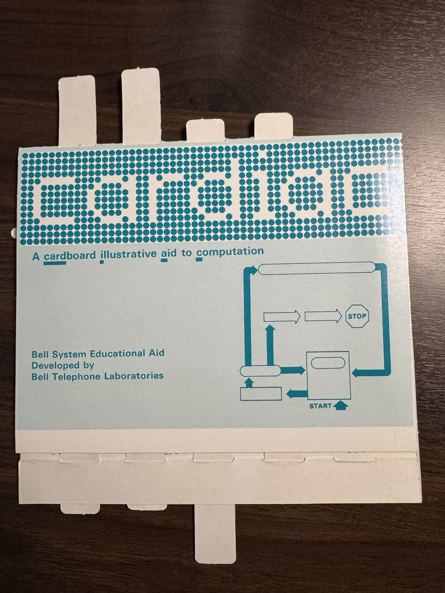

<p align="center"></p>

# cargo-cardiac

Rust compiled to CARDIAC.

Write an ordinary Rust program, build it with cargo and run it. Then build it for CARDIAC: `cargo cardiac build`
turns it into a deck, the cards a CARDIAC loads a program from. Run the deck with burn, from
[cardiaq](https://github.com/StrangeQuery/cardiaq), or open it in [Cardigan](https://lab.strangequery.com/cardigan/)
and step through it, one instruction at a time.

## CARDIAC

CARDIAC (CARDboard Illustrative Aid to Computation) was a paper computer that Bell Labs gave to schools in 1968. You
were the processor: you slid the cardboard to move the program counter and worked each instruction by hand, with a
pencil. It has 100 memory cells of three decimal digits and a sign, an accumulator, ten instructions (read a card,
load, add, subtract, store, shift, test for negative, jump, output, halt), a card reader for input and a teletype
for output. There is no multiply, no divide, no stack and no indirect addressing. Cell 00 always holds 001, which is
what lets a deck of cards load itself. Programs and data share cells 03 to 98, 96 cells in all.

<p align="center"></p>

## Getting started

You need rustup (https://rustup.rs, not a distribution's packaged Rust), and burn, from cardiaq, to run what you
build:

    cargo install cargo-cardiac
    brew install strangequery/tap/cardiaq      # burn; or unpack an archive from cardiaq's releases

With Homebrew, `brew install strangequery/tap/cargo-cardiac` installs `cargo cardiac` and burn together.

The compiler runs inside rustc. Its backend is the CARDIAC driver, which is rustc built as a library on one
pinned nightly, `nightly-2026-05-22`, the last of Rust 1.97's. The first time you build a program, `cargo cardiac`
downloads the driver for your platform from this version's GitHub release (about a megabyte). If rustup doesn't
have that nightly yet, it also asks rustup to install it, in its minimal profile: about 550 MB on disk, once. Your
own Rust stays as it is. Programs can use what Rust 1.97 has. To build the compiler from source instead, see
[CONTRIBUTING.md](CONTRIBUTING.md).

`examples/hello.rs` is an ordinary Cargo program. `out()` comes from the `cardiac` crate, a normal dependency:

```rust
//! Hello, world. CARDIAC's teletype prints numbers, so this one counts down: 10, 9, ... 1, 0.
use cardiac::*;

fn main() {
    for n in (0..=10).rev() {
        out(n);
    }
}
```

In a checkout of this repository, in `examples/`, run it, build it for CARDIAC, and run the deck:

    cargo run --bin hello                # 10, 9, ... 0, one number a line
    cargo cardiac build --bin hello      # hello.rs: 1 phase, 8 cells
    burn hello.cqb                       # the same 10, 9, ... 0, on CARDIAC

`cargo cardiac build` writes `hello.cqb`, the deck, and `hello.map`, its panic map, next to `hello.rs`. Leave out
`--bin` to build every program in the package. To watch it run, open Cardigan and drop `hello.cqb` on it. Build with
`--emit deck,listing,map` and drop `hello.cq` and `hello.map` with it, and Cardigan shows the listing too, and says
why the program panicked if it does.

## Your own program

    cargo new countdown
    cd countdown
    cargo add cardiac

Then `src/main.rs`:

```rust
use cardiac::*;

fn main() {
    let mut n = inp();
    while n >= 0 {
        out(n);
        n -= 1;
    }
}
```

    echo 5 | cargo run                  # 5 4 3 2 1 0
    cargo cardiac build                 # src/countdown.cqb and src/countdown.map
    burn src/countdown.cqb -- 5         # the same, on CARDIAC; or: echo 5 | burn src/countdown.cqb

Like `cargo build`, `cargo cardiac build` uses the `dev` profile, `--release` the `release` one, and
`--profile NAME` one of your own. cargo's `dev` profile doesn't suit CARDIAC, so for a dev build `cargo cardiac`
changes five of its settings, and says so each time it builds:

```toml
[profile.dev]
opt-level = 2              # CARDIAC needs rustc's optimized MIR: at opt-level 0 most programs don't compile
incremental = false        # the CARDIAC driver can't build incrementally
debug = false              # debuginfo changes the MIR, and with it the listing
overflow-checks = false    # the checks' code rarely fits in 96 cells
debug-assertions = false
```

It changes only what your Cargo.toml doesn't set, in `[profile.dev]` or for the package. Set any of these yourself
and yours is used, and the note stops mentioning it. `cargo run` keeps cargo's own settings. That means an
overflow `cargo run` panics on goes unchecked on CARDIAC, unless you set `overflow-checks = true`.

## The examples

Each one is in `examples/`, prints the same natively and on CARDIAC (`./test_examples.sh` checks that), and fits in
CARDIAC's 96 cells. All but `collatz` are binaries of the package `examples`, whose `dev` profile is optimized and
has no overflow checks. `collatz` counts on its overflow checks, and a profile is per package, so it is a package
of its own, `examples/collatz/`, built with `-p collatz`.

| program     | what it does                                                                   | input            | cells        |
|-------------|--------------------------------------------------------------------------------|------------------|-------------:|
| `hello`     | counts down from 10 to 0                                                       |                  |  8           |
| `fibonacci` | the Fibonacci numbers up to 987, the last that fits on a card                  |                  | 19           |
| `fizzbuzz`  | FizzBuzz to 100: Fizz prints -3, Buzz -5, FizzBuzz -15                          |                  | 45           |
| `primes`    | the primes below 50, by the sieve of Eratosthenes                              |                  | 83           |
| `gcd`       | the greatest common divisor of two numbers, by Euclid's algorithm              | `252 105`        | 79           |
| `collatz`   | the Collatz sequence from a number, until it reaches 1 (27 overflows: -999)    | `7`              | 46           |
| `sort`      | reads ten numbers, prints them smallest first (selection sort)                 | ten numbers      | 71           |
| `powers`    | 2 to the power n, up to 2^99, as an array of digits; in two phases             | `99`             | 31 + 53 / 28 |
| `cipher`    | substitutes each digit of numbers 0..999 through a key, a resource            | numbers          | 53           |
| `days`      | the days in a month, from a table (13 is out of bounds: a panic, explained)    | `2`              | 31           |
| `days_assumed` | `days` for a deck that only holds 1..12: `assume()` drops the bounds check | `2`           | 21           |
| `runs`      | counts runs of positive cards, keeping three flags as `cardiac::Flag`s        | cards, then `-999` | 57         |
| `rot13`     | ROT13, letters as 1..26: the message is the deck behind the program           | letters          | 37           |
| `guess`     | guess the number: 1 to 100 from a random seed; each guess answered +1 or -1  | a seed, guesses  | 49           |
| `nim`       | the manual's single-pile Nim: take 1 to 3 of ten, never what was just taken   | who starts, moves | 96          |
| `map`       | MapReduce's map: counts the words (1..16) of a shard ended by -999; outputs a deck | words, `-999` | 84         |
| `reduce`    | MapReduce's reduce: adds up the map machines' decks, stacked behind their number | decks         | 94           |
| `voxel`     | a voxel landscape's projection and light, a depth slice at a time: `voxel.sh` draws a picture with it | a slice | 87 |
| `ray/`      | a ray tracer in ten machines, a mirror ball over a checkerboard: `ray.sh` draws a picture with them | a frame | 45 to 91 each |

FizzBuzz prints numbers because CARDIAC's teletype prints nothing else. A negative number reads as a word, since
FizzBuzz itself never prints one. `powers` is bigger than memory: `overlay()` splits it into a phase that works the
digits out and one that prints them, loaded over the first, with the 31 cells of data shared. `cipher` loads its
key with `load_resource("key")`, from `examples/resources/key`. `days_assumed` assumes its month is 1 to 12,
`unsafe { assume(month <= 12) }`, so the bounds check goes. `runs` keeps its flags as `Flag`s, not `bool`s: with
`bool`s it is 76 cells, and `cargo cardiac build` says so. `rot13` reads until the reader is empty, and ROT13 is its
own inverse, so two in a pipe give the message back: `burn rot13.cqb -- 8 5 12 12 15 | burn rot13.cqb` outputs
8 5 12 12 15, HELLO. `map` and `reduce` are MapReduce on cardboard: each map machine counts the words of its own
shard and outputs a deck, and the reduce machine adds up the decks, stacked behind a card saying how many. `voxel`
works out where each piece of a height map shows on a 96-column screen, and how brightly the sun lights it, one depth
slice at a time, the way flight games drew hills in the early 1990s. `voxel.sh` is its host: it reads a height map, a
plain greyscale PGM, runs the deck on burn once for each of 120 slices, near to far, and puts what CARDIAC outputs on
the screen as `voxel.ppm` (and `voxel.png` on a Mac). `craterlake.pgm` is Crater Lake from real elevation data (its
comments say where from), and `terrain.sh` makes up others.

`ray/` traces a mirror ball over a red and cream checkerboard, under a banded sky: the ball reflects the sky, a
light and the floor, and casts a shadow. CARDIAC has no square root, no multiply or divide and no fractions, and no
program of a whole ray tracer would fit in its memory, so the work is split into ten machines, each small enough for
96 cells. `sway` and `hop` work out where the ball is in a frame and how far the floor has scrolled, from the frame
number and a line of a printed sine table, `ray/sine120.txt` (`ray/sine.sh` writes it). `sky` colours a row of sky,
and `zrow` and `floor` a row of the floor, as old racing games drew a road. `span` finds the pixels of a row the ball
covers. For each of those, `norm` finds the ball's surface (a square root, by taking away odd numbers) and the ray
that bounces off it, `bounce` sends that ray to the light, the sky or the floor, and `hit` finds the checker a ray
lands on. `compose` lays the ball over the row. `floor` and `compose` come in two phases. `ray.sh` is the host: for a
frame, `FRAME=0` to `119`, it runs the decks on burn, about 1,600 runs, passes each machine's output to the next,
looks up the colour codes in a palette and writes a 96 x 48 picture, `ray.ppm` (and `ray.png` on a Mac). Every
colour code in the picture is CARDIAC's.

## What Rust is supported

rustc does all of the front end: parsing, type checking, the borrow checker. A program it rejects never reaches
CARDIAC, and you get Rust's own errors. cargo-cardiac compiles what rustc writes out. In short:

- **Works well:** `i16` (a card's -999..=999), `u8`, `usize`, `bool`; `+`, `-` and comparisons, `*` by a constant,
  `/` and `%` by a power of ten; `if`, `while`, `loop`, `match` on integers, `for` over a range; fixed-size arrays,
  `const` tables, tuples, structs of scalar fields with methods; functions, traits, inlined generics and closures;
  `&mut` and array references; bounds and overflow checks, `assert!`, `panic!()`.
- **Works, but costs more than it looks:** `*`, `/` and `%` of two variables (a multiply or divide routine, and as
  many steps as the numbers are big), arrays passed by value (copied at every call), anything read through an
  index or a pointer (self-modifying code), arrays of structs (one array per field), overflow checks on.
- **Enums:** C-like ones are one cell. An enum with data, and so `Option` and `Result` with `?`, `if let`,
  `unwrap_or` and the like, is a tag cell and its fields' cells.
- **Refused:** other integer types and floats; bit operations; strings and the heap; slices and iterators other
  than ranges; arrays of arrays; recursion; `static`; `println!`, `assert_eq!`. The build stops with an error,
  which for the common cases says what to write instead.

[docs/RUST.md](docs/RUST.md) has the whole list, each entry checked by running it both ways, with what each costs
and what to write instead.

## The built-ins

From the `cardiac` crate (`use cardiac::*;`):

| built-in                | on CARDIAC                                                                | with `cargo run`                            |
|-------------------------|---------------------------------------------------------------------------|---------------------------------------------|
| `inp() -> i16`          | INP: reads the next card                                                  | the next number on standard input           |
| `out(v: i16)`           | OUT: outputs a value                                                      | prints `v` on a line of its own             |
| `overlay()`             | HRS n: stops for deck n, the next phase, whose code loads over this one's | nothing                                     |
| `load_resource("NAME")` | an array the loader fills with the resource NAME: no code                 | `resources/NAME`, read when it runs         |
| `digit(v, k)`           | digit k of v (0 the hundreds, 1 the tens, 2 the units), by a shift        | the same, in arithmetic                     |
| `skip_cards(n)`         | reads n cards (0..=999) and drops them, by a jump into a row of `INP 00`  | n calls of `inp()`                          |
| `add_times(c, n)`       | `n * c` (n 0..=99), by a jump into a row of `ADD c`                       | `n * c`                                     |
| `assume(cond)` (unsafe) | `core::hint::assert_unchecked`: no code, so checks it proves can go       | `assert!`                                   |
| `Flag`                  | a `bool` kept as -1 (false) or 0 (true): a test is its sign               | a plain `i16`                               |

Natively, `inp()` takes numbers separated by spaces or new lines. When there are none left the program stops, as
CARDIAC stops when its reader is empty.

**Overflow.** With overflow checks on, arithmetic that leaves -999..=999 panics. With them off, a cell keeps the low
three digits and the program carries on. Natively, `out()` of a value no card holds panics, and every native panic
prints -999 first, the value CARDIAC's panic routine outputs. So a program whose values fit on a card prints the
same both ways.

**Phases.** A program bigger than memory comes in phases: `NAME.cqb`, then `NAME.2.cqb`, and so on. The data is
shared, and each phase's code is loaded over the one before. `overlay()` in `main` says where a phase ends, or the
compiler places the phases itself when the package turns `auto-overlay` on (`--auto-overlay` for a single file):

```toml
[package.metadata.cardiac]
auto-overlay = true
```

**Resources.** `load_resource("NAME")` is an array the program doesn't build but finds in memory: `let key: [i16;
10] = load_resource("key");`. Its values are the file `resources/NAME` beside the package's `Cargo.toml`, numbers
written as the input is. On CARDIAC the loader puts them in memory with the program, which costs no code. A resource
is loaded once, in `main` and outside any loop.

**skip_cards and add_times.** The cheapest way on CARDIAC to do one thing n times is a row of the same
instruction, entered by a jump the program builds itself, n cells from its end. `JMP 80` is the number 880, so
`CLA k880 / SUB n / STO next` makes the next cell `JMP (80 - n)`, and exactly n of the row run. A counted loop takes
6 or 7 instructions a pass, so for n below about 4 the loop is cheaper, and a constant n is cheaper still.

## Decks and panics

A deck (`NAME.cqb`) is plain text, one card per line, as a signed number (`002`, `-005`), nothing else. It starts
with two cards, 002 and 800, which turn cells 01 and 02 into a loader. Then come pairs, an address card and the value
for that cell, and it ends with the pair 002 8xx, a jump to the program's start. Cells that start at 0 are left out.
The program's input comes after the deck. Any CARDIAC that follows the 1968 manual can load it.

On CARDIAC a panic is the value -999 and a halt. `cargo cardiac build` also writes a panic map, `NAME.map`, beside
the deck, as a .pdb sits beside an .exe: where the program's checks are, and what each one checks. The deck is the
same with or without it. With the map beside the deck, burn says why a run panicked and exits 101, as `cargo run`
does:

    $ echo 13 | burn days.cqb
    -999
         halted after 103 instructions
    burn: days.cqb: panicked in main: index out of bounds

Cardigan reads the map too, when it is opened with the deck.

## Where to run it

A deck is an ordinary CARDIAC deck, so it isn't tied to our tools. These are the places we know it runs:

- **[burn](https://github.com/StrangeQuery/cardiaq)**, cardiaq's runtime, from the command line. It's fast, it
  reads the panic map, and it loads the later decks of a program in phases (`NAME.2.cqb`, ...) when the program
  asks for them.
- **[Cardigan](https://lab.strangequery.com/cardigan/)**, in the browser. Drop the deck on it to step through the
  program one instruction at a time, and drop the listing and the panic map with it to see the source and why a
  run panicked.
- **[Brian Stuart's simulator](https://www.cs.drexel.edu/~bls96/museum/cardsim.html)**, from his
  [CARDIAC page](https://www.cs.drexel.edu/~bls96/museum/cardiac.html) at Drexel. This is the best-known CARDIAC
  simulator, and the one we check against. Paste the deck into the Deck box with the program's input after it,
  then press Load, Reset and Run. Every example prints there exactly what it prints on burn and with `cargo run`.
  The exception is a program in phases: the simulator has no way to load a second deck, so only single-phase
  programs run there.
- **[Brent Wilkins's simulator](http://cardiac.wilkins.in/)**
  ([source](https://github.com/BrentWilkins/CARDIAC)). Paste the deck and the input into the Input box and press
  Run. Its SFT instruction has a bug: it uses a variable that doesn't exist, so the first shift stops the
  program. Programs that never shift run correctly. Of the examples, those are hello, fibonacci, fizzbuzz,
  primes, gcd, sort, days, runs, rot13 and nim. collatz, cipher, guess and voxel shift, so they stop there.
- **[CardiacVisualizer](https://github.com/Xukay101/CardiacVisualizer)**, a desktop emulator in Rust. It has two
  bugs. ADD sets the sign flag from the number it adds instead of from the sum, so a TAC after an ADD can go the
  wrong way. And a TAC that jumps also writes cell 99, which only JMP should do, so it wipes out a subroutine's
  return address. Every example runs correctly except collatz and voxel, which hit them. With both fixed, all of
  them run.
- **[jawhitti/Cardiac](https://github.com/jawhitti/Cardiac)**, a 2016 interpreter and debugger in C#. Its SFT
  doesn't keep the accumulator to four digits, so digits that should drop off the top come back, and cipher and
  voxel go wrong. Its command line only takes inputs from 1 to 999, and it reads a path that starts with `/` as
  an option. To get around both, append the input cards to the deck file and pass the file by a relative path.
  When a program runs out of input it throws an exception, where CARDIAC simply stops. Every other example runs
  correctly.
- **[cinc](https://sourceforge.net/projects/cinc/)**, in Java (jcinc), with a window or a command line:
  `java -jar jcinc.jar -c -i DECK`, with the input after the deck in the same file. When the card reader is empty,
  INP reads -999 and the program carries on, where CARDIAC stops. So a program that reads until the cards run out
  never ends there: cipher and rot13 run forever. Every other example runs correctly.
- **[coronariac](https://github.com/pabloleonor/coronariac)**, in Java. It can't run a deck. Cell 00 starts out as
  000 rather than 001, so there's no loader, and nothing a deck holds ends up where it belongs. With 001 put in cell
  00 by hand it gets further, but its accumulator isn't one register. CLA sets one operand and ADD adds a second
  without carrying the sum forward, so a store after a load writes 0. Only hello and days come out right.

We haven't checked [Kaleberg's CARDIAC](http://www.kaleberg.com/software/cardiac/), which is a closed-source
download, or Al Williams's [spreadsheet](http://www.drdobbs.com/embedded-systems/cpu-design-on-paper/240153480)
and [FPGA](http://www.drdobbs.com/embedded-systems/paper-to-fpga/240155922) versions.

## The command

    cargo cardiac build [--manifest-path PATH] [-p NAME] [--release | --profile NAME] [--bin NAME]...
    cargo cardiac build [-C opt-level=N] [-C overflow-checks=on|off] [-C debug-assertions=on|off] [--auto-overlay] FILE.rs...
    cargo cardiac build --emit deck,listing,map,asm ...

The settings are cargo's. A package is built with the `dev` profile, `--release` with `release`, and `--profile
NAME` with a profile of the workspace's `Cargo.toml`, resolved by cargo itself. Its `opt-level` is rustc's, and it
also says how hard the compiler's own passes work: none at 0, all of them from 1 up. A single file has no
`Cargo.toml`, so it takes rustc's own flags instead, with rustc's defaults.

`--emit` chooses what build writes beside each program: `deck` (`NAME.cqb`), `listing` (`NAME.cq`, the program in
Brian Stuart's six columns, which carc assembles), `map` (`NAME.map`) and `asm` (the compiler's own assembly,
`NAME.asm`). A listing and the assembly name each cell after the variable it holds, where the source has one (`n`,
or `main_n` when another function has an `n` too), and say each line as the Rust it came from (`height = cell / 10`).
The default is `deck,map`. `-q` says only errors, `-v` also says where the cells go, and
`--message-format=json` says it all as JSON Lines on standard error, as cargo does.

The target is `cardiac-unknown-none`, a notional triple: rustc doesn't know it, so there is no `--target` to give,
and `cargo build` builds natively. `cargo cardiac` is what builds for CARDIAC, with the CARDIAC driver as rustc.

## How it works

    Rust --rustc (the CARDIAC driver)--> MIR --cargo-cardiac, in rustc--> CARDIAC assembly --assembler--> deck

`cargo cardiac build` reads the package with `cargo metadata`, then runs `cargo check` on it with the profile, in a
target directory of its own, with the CARDIAC driver as cargo's rustc. The driver is rustc with a CARDIAC backend:
when rustc has analysed a program, the driver turns its MIR into the compiler's IR and compiles it in rustc's
process. The crates a program uses are built with `-Zalways-encode-mir`, so whatever `main` reaches is compiled,
whichever crate it is in.

The compiler (`src/compile`) works in these steps:

- **IR.** Each crate's MIR, from rustc_public inside rustc, is made into a typed IR (`ir`), named as rustc names it
  (`driver/src/convert.rs`). The crates' items are joined into one program (`crates`).
- **Front end.** The program is put in the terms the passes expect (`front`).
- **Passes.** Typed transformations on each function's blocks. `for` loops become counter loops and structs
  become plain locals; then range analysis drops the checks it can prove, copies are forwarded, repeated work is
  done once, sums are folded, INP and OUT go straight to array elements, and cells are shared between values never
  live together.
- **Lowering.** Each function becomes machine IR (`lower`, `machine`): typed lines of instructions, labels and data
  cells. The runtime routines the program needs are added (`runtime`).
- **Peephole.** The peephole rules and the block layout rewrite the machine lines (`peephole`).
- **Phases and deck.** A program in phases is split into its data and each phase's code (`phases`). The assembler
  places them from cell 03, and the deck and the panic map are written (`tape`, `panics`).

Calls use CARDIAC's own convention: JMP leaves a return instruction in cell 99, the callee keeps it, and `return`
jumps back through it. Indexing an array by a variable is self-modifying code, as it was by hand. Why things are the
way they are: `docs/DECISIONS.md`.

## Optimizer

On from opt-level 1 up. At opt-level 0, the default of cargo's `dev` profile and of rustc, it is off and the MIR
is lowered as rustc wrote it.

| test program              | literal lowering  | `cargo cardiac build` |
|---------------------------|------------------:|----------------------:|
| countdown                 |                54 |                     8 |
| Fibonacci                 |                70 |                    17 |
| add() in a loop           |                76 |                    33 |
| nested calls              | 104 (doesn't fit) |                    49 |
| FizzBuzz 1–100            | 285 (doesn't fit) |                    47 |
| arrays + borrowed array   | 225 (doesn't fit) |                    54 |
| &mut references           | 119 (doesn't fit) |                    77 |
| raw pointers              | 109 (doesn't fit) |                    36 |

Cells, for the programs in `tests/programs`. "Literal lowering" is MIR at opt-level 0, overflow checks on, with the
optimizer off; `cargo cardiac build` is opt-level 2, overflow checks off.

## Developing cargo-cardiac

[CONTRIBUTING.md](CONTRIBUTING.md) says how to build and test the compiler, and how to send us a pull request.

The compiler's test programs in `tests/programs` are single files that define the built-ins they call themselves,
as stubs the compiler knows by name, so they need no package and no `cardiac` crate:

```rust
#![no_std]
#[inline(never)]
pub fn out(_v: i16) {}

pub fn main() { out(7); }
```

The tests run decks on burn: the one on the PATH, or the one `BURN` names.

    ./test_compiler.sh       # every test program in tests/programs natively and on CARDIAC, outputs compared;
                             # and the programs that must not compile
    ./test_examples.sh       # every example: cargo run against its deck on burn
    ./fuzz.sh                # the programs in tests/fuzz/targets on generated inputs, natively and on CARDIAC,
                             # every opt-level with overflow checks on and off (--runs N, --seed S, --only NAME)
    ./fuzz.sh --generate 200 # 200 generated programs, each built in those settings and run so
    ./fuzz.sh --repro F.rs -- 3 4   # one program built in every setting and run on that input, both ways
    ./ir_check.sh            # the driver's IR, built from rustc_public, against the IR parsed from rustc's MIR text
    cargo test               # the compiler's own unit tests

`cargo cardiac test` is the compiler's own test command, which the scripts use. It compiles a program as the tests
do, writes its IR printed as MIR (`.mir`) and its assembly (`.asm`) beside it, runs it from `main_bb0` on the
input, and prints the values it outputs on one line:

    cargo cardiac test [-C opt-level=N] [-C overflow-checks=on|off] [-C debug-assertions=on|off] FILE.rs [-- INPUT...]
    cargo cardiac test [--manifest-path PATH] [-p NAME] [--release | --profile NAME] --bin NAME [-- INPUT...]

## Limits

Memory is 96 cells for code and data together, per phase. The compiler is pinned to rustc 1.97's MIR: the driver is
built on that version's last nightly, with `rustc-dev`, whose interfaces change from one nightly to the next, so a
newer Rust means porting the driver.
